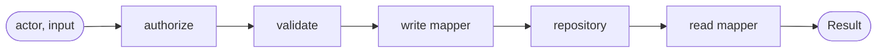

# Backend Domain

Every domain is built in the same places and runs through the same flow. This
skill says what to do and in which order. It carries no code: the salon
domain is the model to read (`salon` in each place below), and the service
categories (`service-category`) are the model of data that belongs to a salon.

## Order of the work

1. **Table.** A SQL migration, then `pnpm db:migrate`, `pnpm db:introspect`
   and `pnpm db:generate-sql`. `schema.ts` is generated and never edited.
2. **Contract.** The models and operations in TypeSpec (`specs/`), then
   `pnpm generate`. A property has the name and the nullability of its column.
3. **Domain, infrastructure, API**, in the places below.
4. **Tests** of each layer, to 100% coverage of the package.
5. **Requirements.** The rules go where the skill `requirements-docs` says.

## Where each piece is

Paths are below `backend/packages/`; `<domain>` is in kebab-case.

| Piece | Place | What it holds |
|-------|-------|---------------|
| Models | `domain/src/models/<domain>.ts` | Types only: the branded ID, the generated API types, the row types inferred from the schema |
| Schemas | `domain/src/schemas/<domain>.schema.ts` | One Zod schema for a request, `satisfies z.ZodType<Generated>`. Rules of more than one domain are in `schemas/rules.ts` |
| Mappers | `domain/src/mappers/write/`, `mappers/read/` | Write: a checked request to a row, the changes of one, the criteria of a list. Read: rows to a response, a page |
| Repository contract | `domain/src/repositories/<domain>.repository.ts` | Methods that answer a `Result`; what can come of a call is a sum type |
| Use cases | `domain/src/business-logic/<domain>/` | One use case in a file. Pure rules are in `_shared/`: who may (`authorization.ts`), what needs the clock or the stored row (`rules.ts`) |
| Repository | `infrastructure/src/repositories/<domain>.repository.impl.ts` | The SQL. What repositories share is in `repositories/_shared/` |
| Handlers | `api/src/routes/<domain>/` | One handler for an operation (`<action>-<domain>.handler.ts`), the router in `index.ts` |
| Wiring | `api/src/index.ts` | The repositories, created once, and the routers, mounted |
| Tests | `__tests__/` of the folder they test | Unit tests in the domain package, integration tests against PostgreSQL in infrastructure and api |

## The flow of a use case



1. **Authorize** from the actor, first. A refusal is `DomainErrors.forbidden()`.
2. **Validate** the input with the schema of the request (`parseWith`). Nothing else validates.
3. **Write mapper.** A checked request goes to it and nowhere else, also where nothing is converted.
4. **Repository.**
5. **Read mapper.** What the use case answers with comes from it.

A step that fails is returned as it is. `use-case-flow.test.ts` of the domain
package fails a use case that leaves this flow.

## Rules that decide a design

- **No `any`, `as`, type guard or `throw`.** State is a sum type, a failure is a `Result`, a `match` is `.exhaustive()`.
- **The database is the source.** Mappers change representations and never a name. A value that is null stays null.
- **Create** takes every property (a value may be null). **Update** is `PATCH`: an absent property is left alone, `null` clears, and at least one property is named.
- **A rule that ties two properties**, or needs the stored row, is a pure function: the use case calls it for a create, the repository calls it inside its transaction for an update.
- **A text an error tells** is a message of `@beauty-salon-shared/i18n`, written in every language. A string does not compile.
- **A repository** writes in a transaction, turns an unexpected failure into a `database` error, does not show deleted rows, pages by keyset, and takes the time of a write from the database.
- **A handler** is created from its dependencies and reaches for no global. `authenticated` wraps one that needs a signed-in user. It matches the result and sends an error with `sendProblem`.
- **Data of a salon** is mounted below `/salons/:salonId`, and every repository method takes the salon: a row of another salon is not found.
- **Why code is as it is** is a comment at that code, not a document.
- **YAGNI.** Nothing for the future, nothing unused.

## Tests

- Schemas, mappers and use cases: unit tests in the domain package.
- The repository: integration tests in infrastructure, on a database of each test.
- Every endpoint: an integration test in api, with at least five error cases.
- Names are English sentences that begin with `should`; the body has `// Arrange`, `// Act`, `// Assert`.

## Checks

```bash
pnpm generate && pnpm check:api-db   # the contract, the generated files, the tables
pnpm lint && pnpm format:check
pnpm build && pnpm typecheck
pnpm test                            # unit tests
pnpm test:coverage                   # unit and integration tests, 100% (needs Docker)
```
