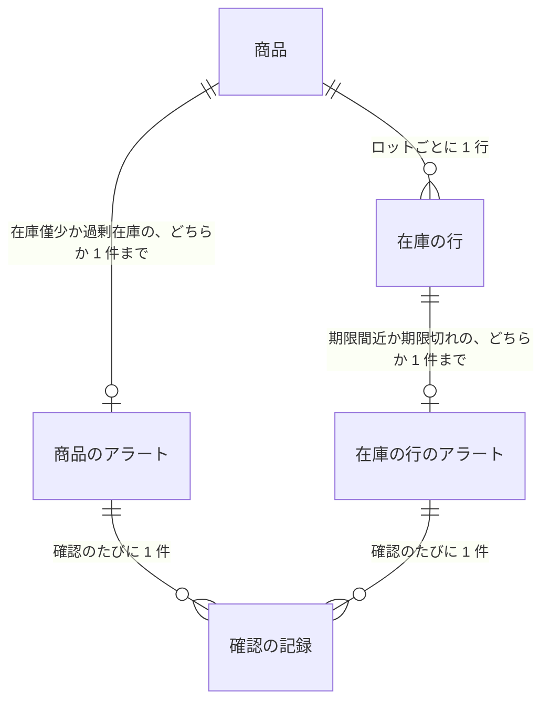
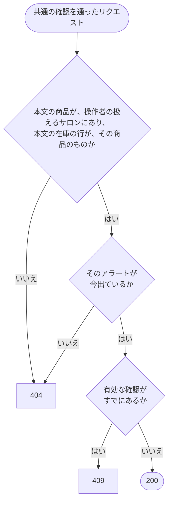

# 在庫のアラート

在庫のアラートは、サロンの在庫について、スタッフが手を打つことを知らせます。商品の在庫が足りないか多すぎること、在庫の行の使用期限が近いか過ぎたことです。アラートを確認すると、誰がいつ確認したかが残ります。

## 何をどこに持つか

- **アラートは保存しません。保存するのは、確認の記録だけです。** アラートは、読むたびに、商品、在庫の行、在庫の移動から求めます。それで、アラートは、いつも今の在庫のものです
- **在庫僅少、期限間近、期限切れのアラートは、在庫の一覧と同じ条件で出ます。** 在庫僅少のアラートが出る商品は、閾値を指定しない在庫僅少の一覧（`listLowStock`）に在庫が載る商品です。期限間近か期限切れのアラートが出る在庫の行は、日数を指定しない、期限の近い在庫の一覧（`listExpiring`）に載る行です

アラートのもとになる情報は、次の場所にあります。

| 情報 | 場所 |
|---|---|
| 最低在庫数と最大在庫数、商品を取り扱い中かどうか | [商品](./products.md) |
| 在庫数、使用期限、在庫の移動 | [在庫](./inventory.md) |

## 誰が扱えるか

**アラートを読み、確認できるのは、そのサロンの在庫を読める人です。** アラートに手を打つのは、日々在庫を扱う人だからです。

## 確認の順序

どの API にも共通の確認（認証、権限、ID と値の形）のあと、次の順に確かめ、合わなかったところのステータスを返します。そのオペレーションにない確認は、飛ばします。

**アラートの確認（`acknowledge`）は、本文が指す商品や在庫の行がないときも、400 ではなく 404 です。** 本文の `alert`、`productId`、`inventoryId` が、確認するアラートそのものを指すからです。アラートには ID がないので、パスの代わりに本文で指します。指した商品や在庫の行がなければ、そのアラートは、今出ていないアラートと同じです。

## 確認が有効なあいだ

**確認が有効なのは、次の条件に合うあいだです。** 条件に合わなくなったアラートは、同じアラートでも、状態が変わっていて、まだ誰も見ていないアラートだからです。有効な確認がないアラートは未確認で、もう一度確認できます。

| アラート種別 | 確認が有効な条件 |
|---|---|
| `low_stock` | 最低在庫数が、確認したときの `threshold` と同じ。確認してから、在庫の和が最低在庫数を超えたことがない。`warning` で確認したものは、在庫の和が 0 になったこともない |
| `overstock` | 最大在庫数が、確認したときの `threshold` と同じ。確認してから、在庫の和が最大在庫数以下になったことがない |
| `expiring`、`expired` | 在庫の行の使用期限が、確認したときの `expiryDate` と同じ。確認してから、その行の在庫の移動が、行の在庫を 0 にしたことがない |

- 在庫を補充して最低在庫数を超え、また減って在庫僅少に戻ったアラートは、未確認です。新しく足りなくなったからです
- 在庫切れ（`critical`）は、`warning` の確認では済みません。`critical` で確認したものは、在庫が戻って `warning` に変わっても有効です
- 最低在庫数か最大在庫数を変えると、商品のアラートの確認は有効でなくなります。比べる数が変わったからです
- 確認は、アラート種別ごとです。期限間近で確認した行が期限切れになると、別のアラートで、未確認です
- 商品の取り扱いをやめると、商品のアラートは出なくなります。取り扱いを再開すると、アラートは、有効だった確認とともに戻ります。取り扱いの停止と再開は、在庫の和も、比べる数も変えないからです
- 商品のアラートでは、同じ時刻に記録した在庫の移動を、まとめて 1 回の変化として数えます。棚卸しは、何行かの在庫数を同じ時刻に書くからです。行のあいだで数が動いただけなら、在庫の和は変わっていません

## 規則に合わない値の答え

在庫のアラートの規則に合わない値は、400 の `errors` に、次の `field` と `rule` で入ります。

| 誤り | `field` | `rule` |
|---|---|---|
| 商品のアラート（`low_stock`、`overstock`）の確認に、在庫の行を指定した | `inventoryId` | `custom` |
| 在庫の行のアラート（`expiring`、`expired`）の確認に、在庫の行を指定していない | `inventoryId` | `custom` |

## 同時に届いたリクエスト

- **同じアラートの確認が同時に何件届いても、1 件が 200 で、ほかは 409 です。** 同じ商品のアラートの確認は、1 件ずつ行います。あとの確認は、前の確認が書かれたあとの状態で決めます
- **確認は、その商品の更新が終わるのを待ちます。** 更新されたあとの最低在庫数と最大在庫数で決めます。更新でアラートが出なくなっていれば 404 です
- **確認は、在庫の行への書き込みが終わるのを待ちます。** 書き込みは、在庫の移動、棚卸し、発注の入荷、在庫の行の更新と削除です。書き込みが残した在庫数と使用期限で決めます。商品のアラートの確認は、その商品のすべての在庫の行について待ち、在庫の行のアラートの確認は、その行について待ちます
- **確認の途中に届いた在庫の行への書き込みは、確認が終わるのを待ちます。** 書き込みを待った確認の時刻（`acknowledgedAt`）は、待ったあとの時刻です。それで、確認より前に記録した在庫の移動は、確認より前の時刻で、あとに記録した在庫の移動は、あとの時刻です。確認が有効かどうかに数えるのは、確認よりあとに記録した在庫の移動だけです

## 持たないもの

- **アラートを知らせる仕組み（メール、プッシュ通知）。** アラートは、一覧と件数を読んで知ります
- **確認を取り消すオペレーションと、書き換えるオペレーション。** 確認は、条件に合わなくなれば、有効でなくなります（[確認が有効なあいだ](#確認が有効なあいだ)）
- **確認の履歴を読むオペレーション。** 一覧が返すのは、今も有効な確認の記録だけです
- **期限間近とする日数を、サロンごとに変える設定。** 日数は、どのサロンも同じです

## 関連

- プロパティの意味と値の規則、アラートが出る条件、オペレーションごとの権限と応答: コントラクト（`specs/models/inventory.tsp`、`specs/operations/inventory-operations.tsp` の `InventoryAlertCrud`）
- どの API にも共通の規則: [API リファレンス](https://napzak5.github.io/typescript-backend-api-first-lesson/)
- 商品と、その最低在庫数、最大在庫数: [商品](./products.md)
- 在庫の行、在庫の移動、在庫僅少の一覧、期限の近い在庫の一覧: [在庫](./inventory.md)
