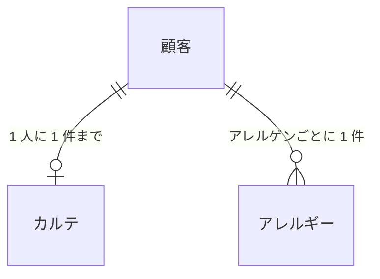
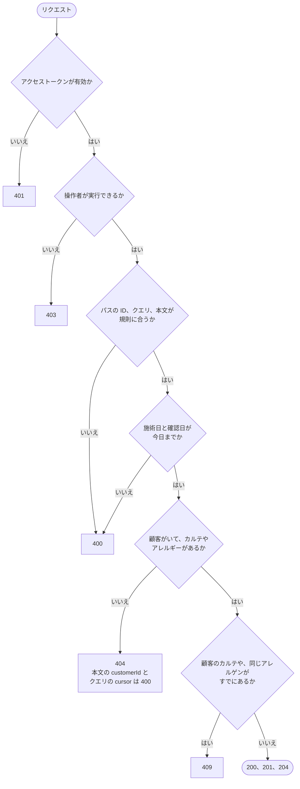

# カルテ

カルテは、施術の前にスタッフが確かめる、顧客の情報です。ほかのサロンで受けた施術、注意が必要な持病や体調、好みの商材と避ける商材、メモを持ちます。顧客のアレルギーは、カルテとは別の記録で、カルテがなくても書けます。

## 何をどこに持つか

カルテにもアレルギーにも持たない情報は、次の場所にあります。

| 情報 | 場所 |
|---|---|
| ふだんの頭皮と髪 | [顧客台帳](./customers.md) |
| 施術のときの頭皮と毛髪の状態、カラー剤の配合 | [施術記録](./treatments.md) |

## 誰が扱えるか

- **どのサロンのスタッフも、どの顧客のカルテとアレルギーも扱えます。** 顧客台帳がプラットフォームで 1 つで、サロンごとに分かれていないからです（[顧客台帳](./customers.md#台帳はプラットフォームで-1-つ)）
- **顧客は、自分のカルテとアレルギーも読めません。** 持病や体調、アレルギーは、スタッフが施術のために書く情報だからです

## 確認の順序

どのオペレーションも、次の順に確かめ、合わなかったところのステータスを返します。そのオペレーションにない確認は、飛ばします。

- 権限のないユーザーには、ID や本文が不正でも、顧客がいなくても 403 です
- パスの ID は、クエリや本文より先に確かめます

## 日付は今日まで

施術日と、アレルギーの確認日は、今日より後にできません。「今日」は、UTC の日付の翌日までです。日本で日付が変わってから、UTC で日付が変わるまでの 9 時間も、日本の今日を書けるようにするためです。

## 規則に合わない値の答え

値の形（型、文字数、件数、形式、定義にないプロパティ）の誤りは、どの API も同じコードで答えます（[Request validation](./uniform-implementation-guide.md#request-validation)）。そのほかの規則は、400 の `errors` に、次の `field` と `rule` で答えます。

| 誤り | `field` | `rule` |
|---|---|---|
| 施術日や確認日が、今日より後 | `previousTreatments.<n>.date`、`confirmedDate` | `too_big` |
| 施術日や確認日が、1900-01-01 より前 | 同上 | `too_small` |
| 商材の名前の 2 度目 | 2 度目の位置（`preferredProducts.<n>`、`avoidProducts.<n>`） | `custom` |
| 更新する項目が 1 つもない | 空文字 | `custom` |
| カルテの作成で、顧客がいない | `customerId` | `not_found` |
| `cursor` が、一覧に載るものを指さない | `cursor` | `not_found` |

## 削除された顧客

顧客は論理削除で、行が残ります（[顧客台帳](./customers.md#削除)）。カルテとアレルギーの行も残りますが、顧客と同じく、ないものとして扱います。

- 一覧にも、件数にも入りません
- 読み書きは、顧客がいないときと同じ答えです

## 同時に届いたリクエスト

- **カルテの作成とアレルギーの追加は、顧客の更新や削除が終わるのを待ちます。** 待った顧客が削除されていれば、顧客がいないときと同じ答えです
- **同じ顧客のカルテの作成が同時に 2 件届くと、1 件が 201 で、もう 1 件は 409 です。** 同じアレルゲンの追加と、同じアレルゲンへの書き換えも同じで、先に確定した書き込みが通り、あとの書き込みは 409 です
- **同じカルテ、同じアレルギーの更新は、1 件ずつ行います。** 違う項目の更新が同時に 2 件届くと、どちらの項目も残ります。同じ項目なら、あとの更新が残ります
- **取得と一覧は、書き込みを待ちません。** 一覧のページと件数は、1 つの時点のものです。一覧の途中に書かれたものは、ページにも件数にも入りません
- **`createdAt` と `updatedAt` は、書いた時刻です。** 待った書き込みは、待ったあとの時刻になります。作成したときの 2 つは、同じ時刻です

## 持たないもの

- **カルテを削除するオペレーション。** 顧客を削除すると、カルテも見えなくなります
- **書き換えの履歴。** 残るのは、最後に書いた時刻（`updatedAt`）だけです。顧客台帳の変更履歴（[変更履歴と版](./customers.md#変更履歴と版)）は、顧客の行の版で、カルテを含みません
- **アレルギーを 1 件だけ読むオペレーション。** アレルギーは、一覧で読みます

## 関連

- プロパティの意味と値の規則、オペレーションごとの権限と応答: コントラクト（`specs/models/treatment.tsp`、`specs/operations/treatment-operations.tsp` の `MedicalChartCrud`）
- どの API にも共通の規則: [Uniform Implementation Guide](./uniform-implementation-guide.md)
