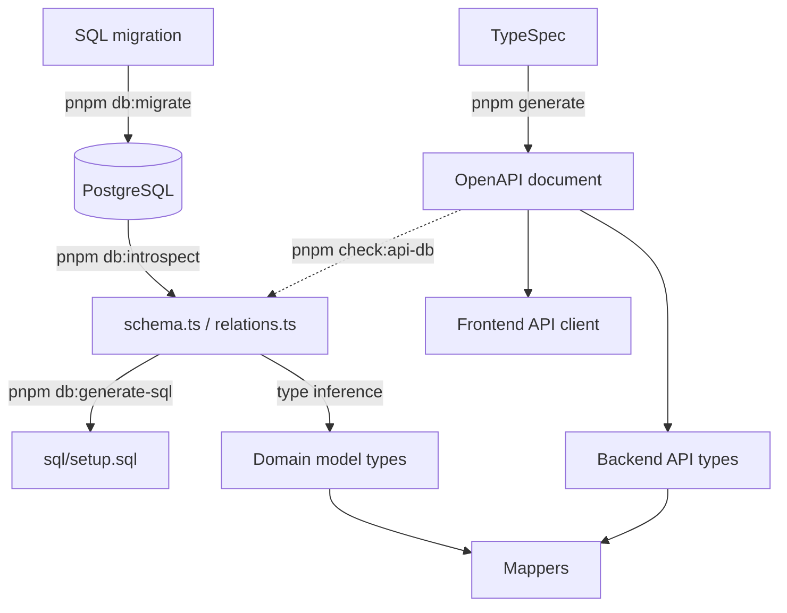
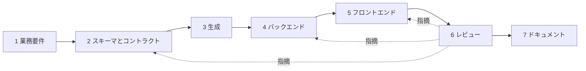

# Multi-Agent Collaboration Framework

このリポジトリに定義されている 8 つの Claude Code サブエージェントが、どの層を担当し、1 つの機能をどの順序で作り、どの時点で何を確認して次の担当へ渡すかを定めます。

コーディング規約は [CLAUDE.md](../CLAUDE.md) が唯一の正です。この文書とエージェント定義は規約を繰り返さず、役割・手順・引き渡しだけを扱います。どのエージェントも作業の前に `CLAUDE.md` を読みます。

## エージェントと担当範囲

定義ファイルは `.claude/agents/<name>.md` です。下の名前は各ファイルの frontmatter の `name` と同じで、作業を委譲するときに指定する名前です。

| エージェント | 担当 | 変更するもの |
|---|---|---|
| `salon-business-expert` | 業務要件 | なし（要件を返す） |
| `database-schema-architect` | データベーススキーマ | `backend/packages/database/`（SQL マイグレーション、生成される `schema.ts`・`relations.ts`・`sql/setup.sql`、シード） |
| `typespec-api-architect` | API コントラクト | `specs/` と、そこから生成されるファイル。API モデルとテーブルの対応を定める `backend/packages/database/src/scripts/api-consistency-rules.ts` |
| `backend-typescript-architect` | バックエンド実装 | `backend/packages/{domain,infrastructure,api,config,utility}`、`backend/apps/server` |
| `senior-ui-designer` | 画面と操作の設計 | なし（設計仕様を返す） |
| `senior-frontend-architect` | フロントエンド実装 | `frontend/`（生成された API クライアントを除く） |
| `design-review-architect` | 層をまたぐレビュー | なし（指摘を返す） |
| `documentation-specialist` | ドキュメント | `README.md`、`CLAUDE.md`、`AGENTS.md`、`docs/`、`.claude/agents/` |

生成されるファイルは、どのエージェントも手で編集しません。担当エージェントがコマンドで再生成します。

- `pnpm generate` が生成するもの: `specs/tsp-output/`、`backend/packages/generated/src`、`frontend/packages/api-client/src/generated`
- `pnpm db:introspect` と `pnpm db:generate-sql` が生成するもの: `backend/packages/database/src/schema.ts`、`backend/packages/database/src/relations.ts`、`backend/packages/database/sql/setup.sql`

1 つのファイルを変更するエージェントは 1 つです。担当外の層に問題を見つけたエージェントは自分で直さず、報告に書いて担当へ戻します（[差し戻し](#差し戻し)を参照）。

### エージェント間の受け渡し

エージェント同士が直接やり取りすることはありません。エージェントを呼び出すのはメインの Claude Code セッションです。各エージェントは呼び出し元の会話を知らない状態で始まり、最後の報告だけを呼び出し元へ返します。

引き渡しとは、その報告に次の担当が必要とする事実を書き、呼び出し元がそれを次のエージェントへの依頼に含めることです。そのため各定義は、報告に何を書くかを定めています。

## 型の流れ

型を手で書く場所はありません。起点はデータベースと TypeSpec の 2 つで、どちらも生成を経てコードに届きます。

- データベースが正です。API のプロパティ名はカラム名と同じで、カラムが NULL を許すときだけプロパティも nullable です。モデルの種類ごとの必須・任意の規則は `CLAUDE.md` にあります。
- `pnpm check:api-db` が確認するのは、プロパティ名、NULL 可否、必須かどうか、enum の値（カラムが PostgreSQL の enum 型のとき）です。型の表現（`numeric` と number、`timestamptz` と ISO 8601 文字列など）、マッパーが名前を変えていないことは確認しません。これらはレビューで確認します。
- 型の対応は [api-db-type-constraints-mapping.md](./api-db-type-constraints-mapping.md) と、Salon のマッパー（`backend/packages/domain/src/mappers/read/salon.mapper.ts`、`backend/packages/domain/src/mappers/write/salon.mapper.ts`）を参照してください。

## 機能開発の順序

| # | 工程 | 担当 | 次へ渡す前の確認 |
|---|---|---|---|
| 1 | 業務要件 | `salon-business-expert` | ユーザーが要件を確認する（コマンドなし） |
| 2 | テーブルと API コントラクトの設計 | `database-schema-architect`、`typespec-api-architect` | プロパティ名・NULL 可否・enum の値が両者で一致している |
| 3 | 生成 | `database-schema-architect`、`typespec-api-architect` | `pnpm check:api-db`、`pnpm check:db-schema`、`pnpm check:generated` |
| 4 | バックエンド | `backend-typescript-architect` | `pnpm lint`、`pnpm format:check`、`pnpm build:prod`、`pnpm typecheck`、`pnpm knip`、`pnpm test`、`pnpm test:integration` |
| 5 | フロントエンド | `senior-ui-designer`、`senior-frontend-architect` | `pnpm lint`、`pnpm format:check`、`pnpm build:prod`、`pnpm typecheck`、`pnpm knip`、`pnpm test:frontend`、画面を変えたときは `pnpm test:e2e` |
| 6 | レビュー | `design-review-architect` | `make ci-check`、`pnpm check:db-schema` と、コマンドが見ない点の確認 |
| 7 | ドキュメント | `documentation-specialist` | 記載したコマンド・パス・リンク・コード例をコードと照合する |

コマンドは `.node-version` の Node で実行します。実行できなかった確認は、成功したことにせず、実行できなかった理由とともに報告します。

### 1. 業務要件

`salon-business-expert` が、サロンの業務の流れから要件をまとめます。コードもスキーマも書きません。次へ渡すものは次のとおりです。

- ユーザーストーリーと受け入れ条件
- エンティティと属性。属性ごとに、常に値があるのか、未設定があり得るのか（カラムの NULL 可否になります）
- 状態とその遷移（enum の値になります）
- 業務ルールと、起きてはならないこと

### 2. テーブルと API コントラクトの設計

プロパティ名、NULL 可否、enum の値が一致しなければならないので、2 つを合わせて決めます。名前と NULL 可否を決めるのはテーブルで、コントラクトがそれに従います。

- `database-schema-architect` は `backend/packages/database/sql/migrations/` に SQL マイグレーション（`YYYYMMDDHHMM_description.sql`）を書きます。カラム名はデータベース上でも camelCase です。適用済みのマイグレーションは編集せず、新しいものを書きます。
- `typespec-api-architect` は `specs/models/<domain>.tsp` と `specs/operations/<domain>-operations.tsp` を、テーブルのカラム名と NULL 可否に合わせて書きます。

### 3. 生成

次の順に実行します。`pnpm check:api-db` は `schema.ts` と OpenAPI 文書を読むので、両方の生成が済んでから実行します。

| 担当 | コマンド | 結果 |
|---|---|---|
| `database-schema-architect` | `pnpm db:migrate` → `pnpm db:introspect` → `pnpm db:generate-sql` | マイグレーションを適用し、`schema.ts`・`relations.ts`・`sql/setup.sql` を再生成する |
| `typespec-api-architect` | `pnpm generate` | OpenAPI 文書、バックエンドの型、フロントエンドの API クライアントを再生成する |
| `typespec-api-architect` | `pnpm check:api-db` | API モデルとテーブルが一致していることを確認する |

確認する点:

- `pnpm check:api-db` が成功すること。テーブルに対応するモデルは、すべて `api-consistency-rules.ts` に `omittedColumns` 付きで登録されていること（`CLAUDE.md` が定める完了の条件）。食い違いを許容する仕組みはありません。
- `pnpm check:db-schema` と `pnpm check:generated` は、再生成した結果を直前のコミットと比較します。生成物をコミットする前に実行すると、変更された生成物の一覧を出して失敗します。その一覧が、マイグレーションや `.tsp` と同じコミットに含めるファイルです。コミットの後に成功することを確認します。
- `pnpm check:db-schema` は `DATABASE_URL` が指すデータベースを作り直します。ローカルの開発用データベースであることを確かめてから実行します。CI では実行されますが、`make ci-check` には含まれません（`make db-check` が同じコマンドです）。
- マイグレーションのテストは `pnpm test:integration` に含まれます。

次へ渡すもの: 変更したテーブルとカラム（名前、型、NULL 可否）、enum の値、追加・変更したモデルとオペレーション、生成された型の名前。

### 4. バックエンド

`backend-typescript-architect` が Salon ドメインを手本に、`CLAUDE.md` が示す層の順（モデル、リクエストスキーマ、リポジトリのインターフェース、ユースケース、マッパー、リポジトリの実装、ハンドラーとルーター、`createApp` への登録）で実装し、テストを同時に書きます。

- 始める条件: 工程 3 の確認が済んでいること。カラムや API のプロパティが足りない場合は、マッパーで補わずに工程 2 へ戻します。
- 公開（`@useAuth(NoAuth)`）でないオペレーションは、ハンドラーを `authenticated` で包み、ユースケースが `Actor` を受け取って権限を判定します（[authentication.md](./authentication.md) の「新しいオペレーションを保護する」）。
- 確認: 表のコマンド。`pnpm typecheck` はビルドの後に実行します。`pnpm test:integration` には Docker が必要です（`TEST_DATABASE_URL` を設定すると、PostgreSQL のコンテナは起動しません）。
- 次へ渡すもの: 変更したファイル、各エンドポイントの挙動、実行した確認とその結果。

### 5. フロントエンド

- `senior-ui-designer` が画面の設計仕様（コンポーネント、状態、ブレークポイント、アクセシビリティの要件）を作ります。既存のコンポーネントライブラリ（`frontend/packages/ui`）とテーマ（`frontend/packages/theme`）を前提にします。スタイル、コンポーネント、テストの規則は、スキル `frontend-ui` と `frontend-testing`（`.claude/skills/`）にあります。
- `senior-frontend-architect` が、生成された API クライアント（`@beauty-salon-frontend/api-client`）のフックと型を使って実装します。API の型を手で書かず、API のプロパティ名を画面の都合で変えません。画面に必要な項目がコントラクトにない場合は工程 2 へ戻します。

### 6. レビュー

`design-review-architect` はファイルを変更しません。まず表のコマンドを実行し、次に、コマンドが見ない点（型の表現、マッパー、層の依存関係、認証と権限の判定、テストの網羅、不要なコード）を確認します。指摘には場所、理由、修正案、担当エージェント、重大度を付けて返します。指摘は担当へ戻し、修正の後に該当する工程の確認をやり直します。

スキーマとコントラクトだけを対象にしたレビューは、工程 3 の直後にも依頼できます。実装の前に不一致を見つけるほうが、直す範囲が小さくて済みます。

### 7. ドキュメント

`documentation-specialist` が、変更によって事実でなくなった記述を直します。Markdown は Biome の対象外で、自動の検査はありません。記載したコマンド、パス、リンク、コード例を 1 つずつコードと照合します。

## 差し戻し

| 見つかった問題 | 戻す先 |
|---|---|
| API のプロパティに対応するカラムがない、または NULL 可否が違う | カラムを変えるなら `database-schema-architect`、コントラクトを直すなら `typespec-api-architect` |
| `pnpm check:db-schema` が失敗する（`schema.ts` などが古い） | `database-schema-architect` |
| `pnpm check:generated` が失敗する（生成物が古い） | `typespec-api-architect` |
| 画面に必要な項目やオペレーションがコントラクトにない | `typespec-api-architect` |
| 仕様にあるエンドポイントがサーバーに実装されていない | `backend-typescript-architect` |
| 実装が `CLAUDE.md` の規約に反している | その層の実装担当 |
| 文書がコードと違う | `documentation-specialist` |
| コードのほうが誤っているように見える | その層の実装担当（文書の側では直さない） |

下流の層で回避しないことが原則です。マッパーでの名前の付け替え、null の既定値への置き換え、フロントエンドでの型の手書きは、いずれも不一致を隠すだけです。

## 現在の実装範囲

- バックエンドは、コントラクトのすべてのオペレーションを実装しています。TypeSpec にだけあって、テーブルやコードのない機能はありません。何を実装しているかの一覧は、[README の Implementation Status](../README.md#implementation-status) の 1 か所にあります。ドメインごとの規則と、あえて持たないものは、それぞれのドキュメントの「実装範囲」にあります（[ドキュメントの一覧](./README.md)）。`CLAUDE.md`、`AGENTS.md`、エージェント定義は、この一覧を繰り返しません
- 認証はサーバー側のセッションとベアラートークンで行い、認可はユースケースが操作者（`Actor`）から判定します。誰が何をできるかは、[認証と認可](./authentication.md) にあります
- フロントエンドの 3 つのアプリケーションにある画面は、サインインと、portal-app のアカウントの画面（登録と、メールのリンクが指す `/verify-email`、`/reset-password`、`/accept-staff-invitation`）と、サロンを探す画面（`/`）、サロンの詳細の画面（`/salons/:salonId`）、顧客が予約を入れる画面（`/salons/:salonId/services/:serviceId/booking`）、予約の一覧の画面（`/bookings`）、予約の内容の画面（`/bookings/:bookingId`。キャンセルも、ここで行う）、日時の変更の画面（`/bookings/:bookingId/reschedule`）です。そのほかの業務の画面（マイページ、admin-app と dashboard-app の画面）は、まだありません。あるものと、ないものは、[フロントエンドAPI統合ガイド](./frontend-api-integration.md) にあります。
- メールは、認証のメール（メールアドレスの確認、パスワードの再設定、スタッフアカウントへの招待と、パスワードの変更・2 要素認証の有効化と無効化・管理者による 2 要素認証のリセット・バックアップコードの再発行・バックアップコードでのログインの通知）だけを SMTP で送ります。詳細は [email.md](./email.md) を参照してください。
- ファイルの保存先は、添付ファイルのための S3 互換のオブジェクトストレージだけです（ローカルでは、`make infra-up` が起動する SeaweedFS）。ドメインは、ポート `IFileStorage`（`backend/packages/domain/src/services/file-storage.ts`）だけを知り、実装は `S3FileStorage`（`backend/packages/infrastructure/src/storage/s3-file-storage.ts`）です。

## 参照

- [CLAUDE.md](../CLAUDE.md): 規約、コマンド、Salon の参照実装
- [AGENTS.md](../AGENTS.md): エージェントの一覧と、リポジトリで作業するときの決まり
- [README.md](../README.md): セットアップ、コマンド、データベースのワークフロー
- [typespec-api-type-rules.md](./typespec-api-type-rules.md)、[api-db-type-constraints-mapping.md](./api-db-type-constraints-mapping.md)、[db-driven-domain-model.md](./db-driven-domain-model.md): 層の間の規則
- [authentication.md](./authentication.md): 認証と認可
- [testing-requirements.md](./testing-requirements.md): テストの要件

エージェント定義:

- [salon-business-expert](../.claude/agents/salon-business-expert.md)
- [database-schema-architect](../.claude/agents/database-schema-architect.md)
- [typespec-api-architect](../.claude/agents/typespec-api-architect.md)
- [backend-typescript-architect](../.claude/agents/backend-typescript-architect.md)
- [senior-ui-designer](../.claude/agents/senior-ui-designer.md)
- [senior-frontend-architect](../.claude/agents/senior-frontend-architect.md)
- [design-review-architect](../.claude/agents/design-review-architect.md)
- [documentation-specialist](../.claude/agents/documentation-specialist.md)
