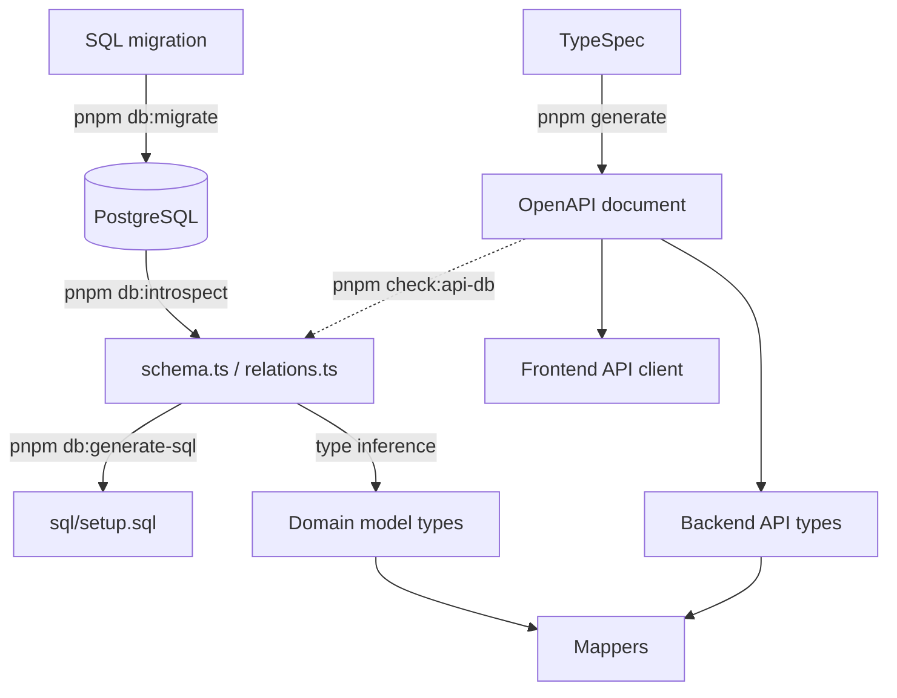
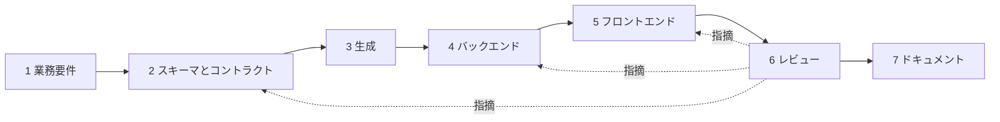

# Multi-Agent Collaboration Framework

このリポジトリに定義されている 8 つの Claude Code サブエージェントが、どの層を担当し、1 つの機能をどの順序で作り、どの時点で何を確認して次の担当へ渡すかを定めます。

コーディング規約は [CLAUDE.md](../CLAUDE.md) が唯一の正です。この文書とエージェント定義は規約を繰り返さず、役割・手順・引き渡しだけを扱います。どのエージェントも作業の前に `CLAUDE.md` を読みます。

## エージェントと担当範囲

定義ファイルは `.claude/agents/<name>.md` です。下の名前は各ファイルの frontmatter の `name` と同じで、作業を委譲するときに指定する名前です。

| エージェント | 担当 | 変更するもの |
|---|---|---|
| `salon-business-expert` | 業務要件 | なし（要件を返す） |
| `database-schema-architect` | データベーススキーマ | `backend/packages/database/`（SQL マイグレーション、生成される `schema.ts`・`relations.ts`・`sql/setup.sql`、シード） |
| `typespec-api-architect` | API コントラクト | `specs/` と、そこから生成されるファイル。API モデルとテーブルの対応を定める `backend/packages/database/src/scripts/api-consistency-rules.ts` |
| `backend-typescript-architect` | バックエンド実装 | `backend/packages/{domain,infrastructure,api,config,utility}`、`backend/apps/server` |
| `senior-ui-designer` | 画面と操作の設計 | なし（設計仕様を返す） |
| `senior-frontend-architect` | フロントエンド実装 | `frontend/`（生成された API クライアントを除く） |
| `design-review-architect` | 層をまたぐレビュー | なし（指摘を返す） |
| `documentation-specialist` | ドキュメント | `README.md`、`CLAUDE.md`、`AGENTS.md`、`docs/`、`.claude/agents/` |

生成されるファイルは、どのエージェントも手で編集しません。担当エージェントがコマンドで再生成します。

- `pnpm generate` が生成するもの: `specs/tsp-output/`、`backend/packages/generated/src`、`frontend/packages/api-client/src/generated`
- `pnpm db:introspect` と `pnpm db:generate-sql` が生成するもの: `backend/packages/database/src/schema.ts`、`backend/packages/database/src/relations.ts`、`backend/packages/database/sql/setup.sql`

1 つのファイルを変更するエージェントは 1 つです。担当外の層に問題を見つけたエージェントは自分で直さず、報告に書いて担当へ戻します（[差し戻し](#差し戻し)を参照）。

### エージェント間の受け渡し

エージェント同士が直接やり取りすることはありません。エージェントを呼び出すのはメインの Claude Code セッションです。各エージェントは呼び出し元の会話を知らない状態で始まり、最後の報告だけを呼び出し元へ返します。

引き渡しとは、その報告に次の担当が必要とする事実を書き、呼び出し元がそれを次のエージェントへの依頼に含めることです。そのため各定義は、報告に何を書くかを定めています。

## 型の流れ

型を手で書く場所はありません。起点はデータベースと TypeSpec の 2 つで、どちらも生成を経てコードに届きます。

- データベースが正です。API のプロパティ名はカラム名と同じで、カラムが NULL を許すときだけプロパティも nullable です。モデルの種類ごとの必須・任意の規則は `CLAUDE.md` にあります。
- `pnpm check:api-db` が確認するのは、プロパティ名、NULL 可否、必須かどうか、enum の値（カラムが PostgreSQL の enum 型のとき）です。型の表現（`numeric` と number、`timestamptz` と ISO 8601 文字列など）、マッパーが名前を変えていないことは確認しません。これらはレビューで確認します。
- 型の対応は [api-db-type-constraints-mapping.md](./api-db-type-constraints-mapping.md) と、Salon のマッパー（`backend/packages/domain/src/mappers/read/salon.mapper.ts`、`backend/packages/domain/src/mappers/write/salon.mapper.ts`）を参照してください。

## 機能開発の順序

| # | 工程 | 担当 | 次へ渡す前の確認 |
|---|---|---|---|
| 1 | 業務要件 | `salon-business-expert` | ユーザーが要件を確認する（コマンドなし） |
| 2 | テーブルと API コントラクトの設計 | `database-schema-architect`、`typespec-api-architect` | プロパティ名・NULL 可否・enum の値が両者で一致している |
| 3 | 生成 | `database-schema-architect`、`typespec-api-architect` | `pnpm check:api-db`、`pnpm check:db-schema`、`pnpm check:generated` |
| 4 | バックエンド | `backend-typescript-architect` | `pnpm lint`、`pnpm format:check`、`pnpm build:prod`、`pnpm typecheck`、`pnpm knip`、`pnpm test`、`pnpm test:integration` |
| 5 | フロントエンド | `senior-ui-designer`、`senior-frontend-architect` | `pnpm lint`、`pnpm format:check`、`pnpm build:prod`、`pnpm typecheck`、`pnpm knip`、`pnpm test:frontend` |
| 6 | レビュー | `design-review-architect` | `make ci-check`、`pnpm check:db-schema` と、コマンドが見ない点の確認 |
| 7 | ドキュメント | `documentation-specialist` | 記載したコマンド・パス・リンク・コード例をコードと照合する |

コマンドは `.node-version` の Node で実行します。実行できなかった確認は、成功したことにせず、実行できなかった理由とともに報告します。

### 1. 業務要件

`salon-business-expert` が、サロンの業務の流れから要件をまとめます。コードもスキーマも書きません。次へ渡すものは次のとおりです。

- ユーザーストーリーと受け入れ条件
- エンティティと属性。属性ごとに、常に値があるのか、未設定があり得るのか（カラムの NULL 可否になります）
- 状態とその遷移（enum の値になります）
- 業務ルールと、起きてはならないこと

### 2. テーブルと API コントラクトの設計

プロパティ名、NULL 可否、enum の値が一致しなければならないので、2 つを合わせて決めます。名前と NULL 可否を決めるのはテーブルで、コントラクトがそれに従います。

- `database-schema-architect` は `backend/packages/database/sql/migrations/` に SQL マイグレーション（`YYYYMMDDHHMM_description.sql`）を書きます。カラム名はデータベース上でも camelCase です。適用済みのマイグレーションは編集せず、新しいものを書きます。
- `typespec-api-architect` は `specs/models/<domain>.tsp` と `specs/operations/<domain>-operations.tsp` を、テーブルのカラム名と NULL 可否に合わせて書きます。

### 3. 生成

次の順に実行します。`pnpm check:api-db` は `schema.ts` と OpenAPI 文書を読むので、両方の生成が済んでから実行します。

| 担当 | コマンド | 結果 |
|---|---|---|
| `database-schema-architect` | `pnpm db:migrate` → `pnpm db:introspect` → `pnpm db:generate-sql` | マイグレーションを適用し、`schema.ts`・`relations.ts`・`sql/setup.sql` を再生成する |
| `typespec-api-architect` | `pnpm generate` | OpenAPI 文書、バックエンドの型、フロントエンドの API クライアントを再生成する |
| `typespec-api-architect` | `pnpm check:api-db` | API モデルとテーブルが一致していることを確認する |

確認する点:

- `pnpm check:api-db` が成功すること。テーブルに対応するモデルは、すべて `api-consistency-rules.ts` に `omittedColumns` 付きで登録されていること（`CLAUDE.md` が定める完了の条件）。食い違いを許容する仕組みはありません。
- `pnpm check:db-schema` と `pnpm check:generated` は、再生成した結果を直前のコミットと比較します。生成物をコミットする前に実行すると、変更された生成物の一覧を出して失敗します。その一覧が、マイグレーションや `.tsp` と同じコミットに含めるファイルです。コミットの後に成功することを確認します。
- `pnpm check:db-schema` は `DATABASE_URL` が指すデータベースを作り直します。ローカルの開発用データベースであることを確かめてから実行します。CI では実行されますが、`make ci-check` には含まれません（`make db-check` が同じコマンドです）。
- マイグレーションのテストは `pnpm test:integration` に含まれます。

次へ渡すもの: 変更したテーブルとカラム（名前、型、NULL 可否）、enum の値、追加・変更したモデルとオペレーション、生成された型の名前。

### 4. バックエンド

`backend-typescript-architect` が Salon ドメインを手本に、`CLAUDE.md` が示す層の順（モデル、リクエストスキーマ、リポジトリのインターフェース、ユースケース、マッパー、リポジトリの実装、ハンドラーとルーター、`createApp` への登録）で実装し、テストを同時に書きます。

- 始める条件: 工程 3 の確認が済んでいること。カラムや API のプロパティが足りない場合は、マッパーで補わずに工程 2 へ戻します。
- 公開（`@useAuth(NoAuth)`）でないオペレーションは、ハンドラーを `authenticated` で包み、ユースケースが `Actor` を受け取って権限を判定します（[authentication.md](./authentication.md) の「新しいオペレーションを保護する」）。
- 確認: 表のコマンド。`pnpm typecheck` はビルドの後に実行します。`pnpm test:integration` には Docker が必要です（`TEST_DATABASE_URL` を設定すると、PostgreSQL のコンテナは起動しません）。
- 次へ渡すもの: 変更したファイル、各エンドポイントの挙動、実行した確認とその結果。

### 5. フロントエンド

- `senior-ui-designer` が画面の設計仕様（コンポーネント、状態、ブレークポイント、アクセシビリティの要件）を作ります。既存のコンポーネントライブラリ（`frontend/packages/ui`）とテーマ（`frontend/packages/theme`）を前提にします。
- `senior-frontend-architect` が、生成された API クライアント（`@beauty-salon-frontend/api-client`）のフックと型を使って実装します。API の型を手で書かず、API のプロパティ名を画面の都合で変えません。画面に必要な項目がコントラクトにない場合は工程 2 へ戻します。

### 6. レビュー

`design-review-architect` はファイルを変更しません。まず表のコマンドを実行し、次に、コマンドが見ない点（型の表現、マッパー、層の依存関係、認証と権限の判定、テストの網羅、不要なコード）を確認します。指摘には場所、理由、修正案、担当エージェント、重大度を付けて返します。指摘は担当へ戻し、修正の後に該当する工程の確認をやり直します。

スキーマとコントラクトだけを対象にしたレビューは、工程 3 の直後にも依頼できます。実装の前に不一致を見つけるほうが、直す範囲が小さくて済みます。

### 7. ドキュメント

`documentation-specialist` が、変更によって事実でなくなった記述を直します。Markdown は Biome の対象外で、自動の検査はありません。記載したコマンド、パス、リンク、コード例を 1 つずつコードと照合します。

## 差し戻し

| 見つかった問題 | 戻す先 |
|---|---|
| API のプロパティに対応するカラムがない、または NULL 可否が違う | カラムを変えるなら `database-schema-architect`、コントラクトを直すなら `typespec-api-architect` |
| `pnpm check:db-schema` が失敗する（`schema.ts` などが古い） | `database-schema-architect` |
| `pnpm check:generated` が失敗する（生成物が古い） | `typespec-api-architect` |
| 画面に必要な項目やオペレーションがコントラクトにない | `typespec-api-architect` |
| 仕様にあるエンドポイントがサーバーに実装されていない | `backend-typescript-architect` |
| 実装が `CLAUDE.md` の規約に反している | その層の実装担当 |
| 文書がコードと違う | `documentation-specialist` |
| コードのほうが誤っているように見える | その層の実装担当（文書の側では直さない） |

下流の層で回避しないことが原則です。マッパーでの名前の付け替え、null の既定値への置き換え、フロントエンドでの型の手書きは、いずれも不一致を隠すだけです。

## 現在の実装範囲

- バックエンドに実装されているのは、Salon ドメイン（`/api/v1/salons`）、サロンのサービスカテゴリー（`/api/v1/salons/{salonId}/service-categories`）、サロンのサービス（`/api/v1/salons/{salonId}/services`。オプションとパッケージを含む）、顧客台帳（`/api/v1/customers`。顧客の一覧、登録、1 件の取得、更新、削除）と顧客本人のプロフィール（`/api/v1/customers/me`）、顧客の好み設定（`/api/v1/customers/{id}/preferences` と `/api/v1/customers/me/preferences`。取得と更新）、予約台帳（`/api/v1/bookings`。予約の一覧、作成、1 件の取得、更新、削除、ステータスの 5 つの操作、日時の変更）、スタッフ台帳（`/api/v1/salons/{salonId}/staff`。スタッフの一覧、登録、1 件の取得、更新、削除）、スタッフの勤務スケジュール（`/api/v1/salons/{salonId}/staff/{id}/schedules`。一覧と、全体を置き換える更新）、スタッフのログインアカウントへの招待（`/api/v1/salons/{salonId}/staff/{id}/invitation`。取得、作成、取り消し。招待された本人による確認、受け入れ、参加は `/api/v1/auth/staff-invitation`）、スタッフに紐づいたアカウント（`/api/v1/salons/{salonId}/staff/{id}/account`。取得、ロールの変更、紐づけの解除）、顧客に見せるスタッフのプロフィール（`/api/v1/staff-profiles`。一覧と 1 件の取得）、スタッフ本人のプロフィール（`/api/v1/staff-profiles/me`。取得と更新）、認証のすべてのオペレーション（`/api/v1/auth` のログイン、トークンの更新、ログアウト、現在のユーザーの取得、ユーザー登録、メールアドレスの確認、パスワードの再設定と変更、スタッフの招待の確認、受け入れ、参加、2 要素認証、セッションの一覧と無効化、および `/api/v1/admin/auth` の管理者の操作）、システムエンドポイント（`GET /api/system/alive`、`GET /api/system/ready`、`GET /api/system/health`）だけです。Salon が、ほかのドメインを実装するときの手本です。データがサロンに属するドメインでは、サービスカテゴリーも手本にします。カテゴリーにないもの（2 つのテーブルの行を持つリクエスト、2 つの項目にまたがる規則、一括更新）は、サービスのファイルにあります。サロンに属さず、公開もしないデータの例は顧客台帳です（ルートをサロンの下に置かない、すべてのオペレーションに認証が要る、権限を操作者だけで最初に判定する）。サロンに属し、公開しないデータの例はスタッフ台帳です（読むのにも認証が要る、操作者自身のレコードを守る規則がある）。サロンの 1 つのレコードに属し、全体を置き換える行の例は、スタッフの勤務スケジュールです（スタッフの下に置くルート、行の配列を本文にする `PUT`、サロンと対象の 2 段階で判定する権限、行をロックして置き換えるトランザクション）。メールで送ったトークンで届くレコードの例は、スタッフの招待です（招待する側のルートと、トークンを持つ人のための公開のルート、本文のロールで決まる 2 つめの権限、結果を直和型で返すリポジトリ、スタッフの行をロックしてから判定し直す書き込み）。ほかのテーブルの行の一部をサロンに扱わせる例は、スタッフのアカウントです（見せるカラムだけを読むリポジトリ、カラムの Enum より狭い API の Enum、操作者自身のアカウントを守る規則）。公開しないデータの一部を誰にでも見せる例は、スタッフのプロフィールです（見せる項目だけのモデルを別に持つ、認証なし、サロンをまたぐ一覧をサロンや専門分野で絞り込む）。レコードの持ち主に、その一部を書かせる例は、スタッフ本人のプロフィールです（パスに ID がなく、対象を操作者から決める。持ち主が書ける項目だけのリクエスト。見せるスタッフの条件を含めた 1 つの文での更新）。行が保存されていなくても、どのレコードにも「ある」データの例は、顧客の好み設定です（作成と削除のないオペレーション、行のない顧客に返す空の値、保存されている値と照らす規則、顧客の行をロックしてから判定する更新）。サロンに属するが、ルートをサロンの下に置かないデータの例は、予約台帳です（操作者に届く範囲を先に決め、リクエストがサロンを指定してから判定する 2 段階の権限。参照する行から書く行を決める純粋な関数。参照する行をロックし、スタッフの占有を確かめてから書くトランザクション。予約の行をロックして読んだステータスから、純粋な関数が次の状態を決める、ステータスの操作）。カテゴリーとサービスの規則は [service-menu.md](./service-menu.md)、顧客台帳の規則は [customers.md](./customers.md)、スタッフ台帳の規則は [staff.md](./staff.md)、予約台帳の規則は [bookings.md](./bookings.md) にあります。
- 認証はサーバー側のセッションとベアラートークンで行い、認可はユースケースが操作者（`Actor`）から判定します。認可が適用されているのは、Salon API（作成・更新・削除）、サービスカテゴリー（作成・更新・削除）、サービス（作成・更新・一括更新・削除）、顧客台帳、顧客本人のプロフィール、顧客の好み設定（すべてのオペレーション）、予約台帳（すべてのオペレーション。顧客のアカウントは使えない）、スタッフ台帳、スタッフの勤務スケジュール、スタッフの招待、スタッフのアカウント、スタッフ本人のプロフィール（すべてのオペレーション）、管理者の操作（ユーザーの参照、ロックの解除、2 要素認証のリセット。使えるのはロール `admin` だけ）です。ユーザー登録で作られるのは `customer` ロールのアカウントだけです。`owner`・`manager`・`staff` のアカウントは、スタッフの招待を本人が受け入れて作ります。すでにスタッフのアカウントを持っていて、どのサロンにも届かない人は、ログインして招待に参加します。`admin` のアカウントを作る API はありません。2 要素認証（認証アプリのコードとバックアップコード）は、利用者が自分で設定します。利用者は自分のセッションの一覧を取得し、1 件ずつ無効にできます。詳細は [authentication.md](./authentication.md) を参照してください。
- 顧客のコントラクト（`CustomerCrud`）のうち、実装されているのは、上の 5 つのオペレーションと、一括取得、一括登録・一括更新・一括削除（100 件まで、すべてか何もしないか）、好み設定の取得と更新、統計（サロンと期間ごとに、予約台帳と売上台帳から数える）、変更履歴と版（台帳に書くたびに残す版）、削除した顧客の復元、2 人の顧客の統合、台帳の CSV 出力と顧客のデータの出力だけです。データ削除要請は実装されていません。顧客本人は、プロフィール（`CustomerProfile`、`/api/v1/customers/me`）で自分の顧客情報を作り、読み、直します。登録したユーザー（ロール `customer`）は、プロフィールを作るまで顧客情報を持ちません。好み設定（希望するスタッフ、避けるスタッフ、希望する時間帯、スタイルの好みなど）は、台帳を扱うユーザーと顧客本人が読み書きします。それを読んで使う処理は、まだありません。予約台帳は、好み設定を見ません。ポイント（`loyaltyPoints`）はポイント台帳が、来店回数などは予約のステータスの操作が更新します。顧客が使った金額は保存せず、統計が売上台帳から数えます。
- スタッフのコントラクトは、すべてのオペレーションが実装されています。台帳の 5 つ、勤務スケジュールの 2 つ、招待の 3 つ、アカウントの 3 つ、顧客に見せるプロフィールの 2 つ、本人のプロフィールの 2 つです。勤務スケジュールを読むのは、空き枠の一覧だけです（予約できる枠を、サロンの営業時間、勤務スケジュール、すでにある予約から決めます）。予約台帳の作成と日時の変更は、勤務スケジュールを確かめません。スタッフ本人は、自分のプロフィールのうち、自分を紹介する 5 項目（専門分野、自己紹介、写真の URL、経験年数、資格）を直せます。顧客に見せる名前、ランク、役職、予約を受けるかどうかは、サロンが台帳で決めます。スタッフ本人が、自分の連絡先や勤務スケジュールを変えるオペレーションはありません。スタッフのログインアカウントは、招待の受け入れで作るか、すでにあるアカウントでの招待への参加で紐づけます。紐づいたアカウントは、管理者とサロンの `owner` が読み、ロールを変え、紐づけを解除します。スタッフ本人がサロンを離れるオペレーション、顧客のアカウントをスタッフのアカウントにするオペレーション、複数のサロンに属するアカウントはありません。
- 予約のコントラクトは、すべてのオペレーションが実装されています。予約台帳の 11 オペレーション（`BookingCrud` の一覧、作成、1 件の取得、更新、削除、ステータスの 5 つの操作: 確定、キャンセル、施術の開始、完了、無断キャンセルの記録、および日時の変更）、施術明細の 3 オペレーション（`BookingServiceCrud` の追加、1 件の取得、削除）、空き枠の 2 オペレーション（`AvailableSlotCrud` の一覧、確認）、顧客が自分で入れる予約の 5 オペレーション（`CustomerBookings` の一覧、作成、1 件の取得、キャンセル、日時の変更）です。空き枠の一覧は、顧客が予約できる枠を返し、サロン、サービス、スタッフの受け付けの設定を適用します。空き枠の確認は、台帳と同じく、スタッフの占有だけを確かめます。作成した予約は `pending` で、ステータスは操作でだけ変わります。操作できるステータスでない予約への操作は 409 です。キャンセル料は、決める規則がないので、常に 0 です。更新で変えられるのは、内金、要望、メモ、受付経路だけです。開始日時と担当スタッフは、日時の変更で変えます（`draft`・`pending`・`confirmed` の予約だけ。施術明細も同じ時間だけ動き、変更前の担当スタッフの明細は新しい担当スタッフに移る）。施術明細は、終わっていない予約（`draft`・`pending`・`confirmed`・`in_progress`）にだけ追加・削除でき、そのたびに、予約の日時と金額を明細から算出し直します。予約には、1 件以上 20 件以下の明細が残ります（409）。明細の担当スタッフや開始日時を変えるには、新しい明細を追加してから、古い明細を削除します。予約を削除できるのは `admin` と、サロンの `owner`・`manager` で、売上か施術記録が参照する予約は削除できません（409）。終わっていない予約（`draft`・`pending`・`confirmed`・`in_progress`）が参照する顧客、スタッフ、サービス、サロンも削除できません（409）。顧客の来店回数、キャンセル回数、無断キャンセル回数と来店日は、ステータスの操作と削除が、顧客の予約から数え直します。サロンが台帳に入れる予約、日時を変える予約、追加する明細について、システムが確かめるのは、データの整合（参照するものが存在し、同じサロンのものであること、スタッフが同時に受けられる数を超えて重ならないこと）だけです。営業時間、勤務スケジュール、スタッフ・サービス・顧客の有効・無効は確かめません。これらは、顧客が予約できる枠を決める設定で、空き枠の一覧と、顧客が自分で入れる予約（`/api/v1/customers/me/bookings`。プロフィールのある `customer` のアカウント）が適用します。顧客が入れられるのは、空き枠の一覧がその時点で返す枠だけで、サービスは 1 つ、ステータスは `pending` です（サロンが台帳で確定する）。`isActive` が false、または `customerStatus` が `inactive` か `blacklisted` の顧客は、自分では入れられません。自分のほかの予約と時間が重なる予約も入れられません（どれも 409）。顧客は、自分の予約（サロンが台帳に入れたものを含む）を、サロン内のメモなどを除いた項目で読み、`draft`・`pending`・`confirmed` の予約を、開始日時より前にだけキャンセルできます。日時と担当スタッフは、明細が 1 件で、その担当が予約の担当スタッフである予約を、開始日時より前に、空き枠にだけ変えられます（確定済みの予約は `pending` に戻り、サロンが確定し直します）。予約の通知、キャンセルと変更の締め切り、キャンセル料はありません。規則は [bookings.md](./bookings.md) にあります。
- 支払いのコントラクトは、売上台帳の 5 オペレーション（`SaleCrud` の一覧、作成、1 件の取得、更新、取り消し）が実装されています。売上は 1 回の会計の記録で、金額はレジが決めたものを保存します。サーバーが確かめるのは、明細がそれ自身と合っていること（数量 × 単価 − 割引 + 消費税）、参照するサロン、顧客、スタッフ、予約、サービス、商品が存在してサロンのものであること、1 つの予約の会計が 1 回であること（409）だけで、料金、税率、歩合とは比べません。扱えるのは `admin` と、売上のサロンの `owner`・`manager`・`staff` で（取り消しは、`staff` を除く）、顧客のアカウントは使えません。更新は、指定した項目だけを変え、更新後の売上を作成と同じ規則で確かめます（明細は全体を置き換え、支払い状態が `pending` の間だけ）。取り消しは、返金していない支払いがある売上を断り（409）、予約をもう一度会計できるようにします。サロンの支払い方法の 5 オペレーション（`PaymentMethodCrud` の一覧、作成、1 件の取得、更新、削除）も実装されています。サロンが受け付ける支払いの手段の設定で、読めるのは `admin` と、そのサロンの `owner`・`manager`・`staff`、設定できるのは `admin` と `owner`・`manager` です。種類（`method`）は作成のあとで変えられず、金額の下限は上限以下で、支払いが指している支払い方法は、削除できません（409。`isActive` を false にします）。売上に対する支払いの記録（`SaleCrud` の `process`）と返金（`PaymentCrud` の `refund`）も実装されています。決済代行会社とは接続しておらず、支払いは、受け取ったお金の記録です。記録できるのは `admin` と、売上のサロンの `owner`・`manager`・`staff`、返金できるのは `admin` と `owner`・`manager` で、売上の支払い状態は、決済取引から決まります。レシート（`GET /api/v1/sales/{id}/receipt`）と、売上を入れる前の金額の計算（`POST /api/v1/sales/calculate`）も実装されています。レシートは、受け取った金額が合計金額に達した、取り消していない売上から、リクエストのたびに作り、保存しません。計算は、何も書かず、予約の施術明細を写した金額で、加えるサービスをいまの料金で数え、消費税を合計に 1 回だけ掛けます。売上レポート（`/api/v1/sales-reports` の期間のレポート、1 日の売上、スタッフ別、カテゴリー別、推移、CSV の出力）も実装されています。読めるのは `admin` と、サロンの `owner`・`manager` で、取り消していない売上から、リクエストのたびに数え、保存しません。期間は、両端を含めて 366 日までです。ポイント台帳（`/api/v1/points` の顧客の残高、履歴、有効期限が近いポイント、付与、利用、調整、失効）も実装されています。台帳はプラットフォーム全体で 1 つで、`admin` と、どのサロンの `owner`・`manager`・`staff` も使え、調整は `staff` が使えず、失効は `admin` だけが使えます。取引のたびに、その後の残高を書き、顧客の残高をそれにします。利用は有効期限の近いポイントから取り、期限を過ぎたポイントは、失効させるまで使えます。規則は [docs/sales.md](./sales.md)、[docs/payments.md](./payments.md)、[docs/sales-reports.md](./sales-reports.md)、[docs/points.md](./points.md) にあります。
- レビューのコントラクトは、一覧、投稿、1 件の取得、修正、削除、参考になった、通報、サロンからの返信（`/api/v1/reviews`）と、通報の一覧と却下（`/api/v1/review-reports`）、サロンとスタッフのレビューの集計（`/api/v1/salons/{salonId}/reviews/summary`、`/api/v1/staff/{staffId}/reviews/summary`）が実装されています。読むのに認証は要らず、投稿できるのは、済んだ予約の顧客本人だけで、1 つの予約に 1 件です。サロンの評価とレビュー件数は、レビューを書いたトランザクションが、レビューから数え直します。修正できるのは書いた顧客だけ、削除できるのは書いた顧客と `admin` で、どちらもサロンを数え直し、値が変わるときだけサロンを書きます。レビューのある予約は、レビューを削除するまで削除できません。参考になったは、顧客が、ほかの顧客のレビューに 1 回だけ付け、`helpfulCount` は評価した顧客の数です。通報は、顧客と、レビューのサロンの `owner`・`manager` が 1 回だけでき、`reportCount` は `pending` の通報の数です。`admin` が通報を却下するか、レビューを削除します。返信は、レビューのサロンの `owner`・`manager` が書き、置き換え、取り下げ、`admin` は取り下げだけができます。規則は [docs/reviews.md](./reviews.md) にあります。
- 在庫のコントラクトは、サロンの商品の 5 オペレーション（`ProductCrud` の一覧、作成、1 件の取得、更新、削除）が実装されています。読めるのは `admin` と、そのサロンの `owner`・`manager`・`staff`、管理できるのは `admin` と、そのサロンの `owner`・`manager` で、顧客のアカウントは使えません。在庫の水準は `minimumStock` ≦ `reorderPoint` ≦ `maximumStock` の順に並び、商品コードは、サロンの削除されていない商品の中で一意です。削除は論理削除で、在庫のレコードがある商品は断ります（409）。
- 在庫のコントラクトは、在庫の行の 7 オペレーション（`InventoryCrud` の一覧、作成、1 件の取得、更新、削除、在庫僅少、期限切れ間近）も実装されています。読めるのは `admin` と、サロンの `owner`・`manager`・`staff`、管理できるのは `admin` と、サロンの `owner`・`manager` です。ロットで分ける商品の在庫の行はロット番号を持ち、分けない商品の行は 1 つまでです。在庫の数は、作成では 0 で、リクエストでは書けません。在庫のある行は削除できません（409）。
- 在庫のコントラクトは、在庫の移動の 2 オペレーション（`InventoryCrud` の `recordMovement`、`listMovements`）と、棚卸し（`performStockCount`）、在庫評価額（`getValueReport`）も実装されています。在庫数を変えるのは在庫の移動と、差を在庫の移動として記録する棚卸しだけで、1 件ずつ、前の移動が残した在庫数から記録します。`staff` が記録できるのは仕入れ、販売、施術での使用、返品で、帳簿の調整、廃棄、ほかのサロンへの移動、棚卸し、在庫評価額は `owner`・`manager` のものです。
- 在庫のコントラクトは、発注の 8 オペレーション（`PurchaseOrderCrud` の一覧、作成、1 件の取得、更新、承認、取り消し、入荷、発注の提案）も実装されています。サロンのメンバーが在庫の行を明細にした下書きを作り、承認待ち、発注済み、出荷済みへ 1 つずつ進め、承認と取り消しは `owner`・`manager` のものです。明細は商品の商品コード、名前、単位を写し、金額はサーバーが計算します。入荷は、発注済みか出荷済みの発注の、届いた明細を仕入れの在庫の移動として記録し、発注を納品済みにします。発注の提案は、在庫と発注中の数量の和が発注点以下の商品と、最大在庫数までの数量を返します。納品済みと取り消し済みの発注は、変わりません。
- 在庫のコントラクトは、在庫のアラートの 3 オペレーション（`InventoryAlertCrud` の一覧、確認、件数）も実装されています。アラートは保存せず、読むたびに、商品、在庫の行、在庫の移動から求めます（商品の在庫の合計が最低在庫数以下か最大在庫数より多い、在庫の行の使用期限が 30 日以内か過ぎた）。読めて確認できるのは `admin` と、サロンの `owner`・`manager`・`staff` です。確認は、確認したときのアラートを記録し、その状態が続くあいだだけ効きます。規則は [docs/inventory-alerts.md](./inventory-alerts.md) にあります。
- 施術記録のコントラクトは、`TreatmentRecordCrud` のすべて（一覧、作成、1 件の取得、更新、削除、写真の追加と削除、統計）が実装されています。施術記録は予約のサロンのもので、読み書きできるのは `admin` と、予約のサロンの `owner`・`manager`・`staff`、削除は `staff` を除きます。顧客は読めません。施術中か完了の予約に 1 件で、顧客、スタッフ、サービス、商品は、予約とそのサロンに照らします。使用商材を記録しても、在庫は動きません。写真は保存先の URL で、施術記録 1 件に 20 枚まで、同じ URL は 1 枚です。公開する写真には顧客の同意が要ります。統計は、期間の施術記録を、サービスの区分ごとと、サービスごとに数えます。規則は [docs/treatments.md](./treatments.md) にあります。
- カルテのコントラクトは、`MedicalChartCrud` の一覧、作成、顧客のカルテの取得、更新が実装されています。カルテは顧客 1 人に 1 件で、過去の施術、注意が必要な持病・体調、好みの商材と避ける商材、メモを持ちます。読み書きできるのは、顧客台帳と同じく `admin` と、どのサロンの `owner`・`manager`・`staff` で、顧客は自分のカルテも読めません。顧客のアレルギーも、一覧、追加、更新、削除が実装されています。アレルギーは顧客のアレルゲンごとに 1 件で、重篤度の重い順に並び、削除できるのは `admin` と `owner`・`manager` だけです。規則は [docs/medical-charts.md](./medical-charts.md) にあります。
- ほかのドメイン（添付ファイルなど）は TypeSpec にだけあり、テーブルも、ドメイン・リポジトリ・ルートのコードもまだありません。
- フロントエンドの 3 つのアプリケーションは、サンプルデータを表示する静的な画面で、まだ API を呼んでいません。ログインやトークンを扱うコードも、メールのリンクが指すページ（`/verify-email`、`/reset-password`）もありません。
- メールは、認証のメール（メールアドレスの確認、パスワードの再設定と、パスワードの変更・2 要素認証の有効化と無効化・管理者による 2 要素認証のリセット・バックアップコードの再発行・バックアップコードでのログインの通知）だけを SMTP で送ります。詳細は [email.md](./email.md) を参照してください。
- ファイルストレージのコードはありません。

## 参照

- [CLAUDE.md](../CLAUDE.md): 規約、コマンド、Salon の参照実装
- [AGENTS.md](../AGENTS.md): エージェントの一覧と、リポジトリで作業するときの決まり
- [README.md](../README.md): セットアップ、コマンド、データベースのワークフロー
- [typespec-api-type-rules.md](./typespec-api-type-rules.md)、[api-db-type-constraints-mapping.md](./api-db-type-constraints-mapping.md)、[db-driven-domain-model.md](./db-driven-domain-model.md): 層の間の規則
- [authentication.md](./authentication.md): 認証と認可
- [testing-requirements.md](./testing-requirements.md): テストの要件

エージェント定義:

- [salon-business-expert](../.claude/agents/salon-business-expert.md)
- [database-schema-architect](../.claude/agents/database-schema-architect.md)
- [typespec-api-architect](../.claude/agents/typespec-api-architect.md)
- [backend-typescript-architect](../.claude/agents/backend-typescript-architect.md)
- [senior-ui-designer](../.claude/agents/senior-ui-designer.md)
- [senior-frontend-architect](../.claude/agents/senior-frontend-architect.md)
- [design-review-architect](../.claude/agents/design-review-architect.md)
- [documentation-specialist](../.claude/agents/documentation-specialist.md)
