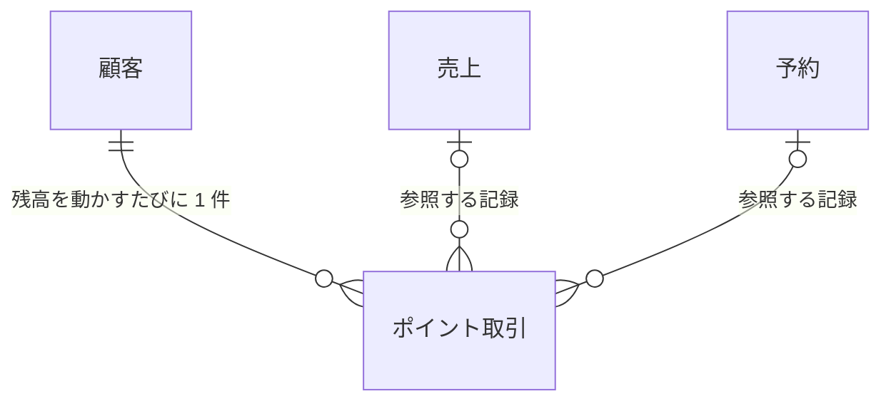
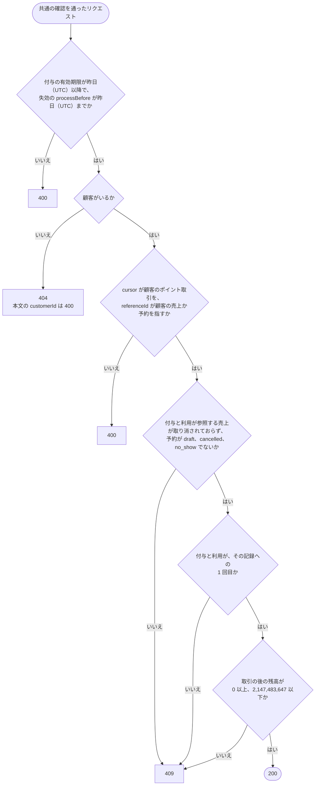

# ポイント台帳

ポイント台帳は、顧客のポイントの残高と、その増減の記録（ポイント取引）です。ポイントは顧客のもので、サロンのものではありません。顧客は、どのサロンで貯めたポイントも、どのサロンでも使えます。付与、利用、調整は、レジで記録します。

## 何をどこに持つか

残高は、顧客が持つ値（`loyaltyPoints`）です。**残高を動かすたびに、ポイント取引を 1 件書きます。** 取引は、増減と、その後の残高を持ちます。顧客の残高は、いつも、最新の取引の残高と同じです。

ポイントのオペレーションのほかに、次の 2 つがポイント取引を書きます。

| 書くもの | 取引 | 場所 |
|---|---|---|
| 顧客の統合 | 統合して削除する顧客の残高を、残す顧客に移す移行（`transferred`） | [顧客台帳](./customers.md#ポイント統合) |
| 顧客のデータの消去 | 残っていた残高の失効（`expired`） | [顧客台帳](./customers.md#消すもの残すもの) |

## 誰が扱えるか

- **どのサロンのメンバーも、どの顧客のポイントも扱えます。** 顧客台帳と同じく、ポイント台帳はプラットフォームで 1 つで、サロンごとに分かれていないからです（[顧客台帳](./customers.md#台帳はプラットフォームで-1-つ)）
- **顧客は、自分のポイント台帳も扱えません。** ポイント台帳は、レジで顧客に応対する人が記録するものだからです。顧客は、自分の残高を、自分のプロフィールの `loyaltyPoints` で見ます

## 確認の順序

どの API にも共通の確認（認証、権限、ID と値の形）のあと、次の順に確かめ、合わなかったところのステータスを返します。そのオペレーションにない確認は、飛ばします。

ポイントの 409 は、どれも `code` が `3003` です。

## 参照する記録

付与、利用、調整は、もとになった売上か予約を参照できます。

- **参照できるのは、本文の顧客の売上と予約です。** ほかの顧客の記録、顧客を記録していない売上、`referenceType` と種類の違う記録は、存在しない記録と同じ答えです
- **サロンのメンバーが参照できるのは、自分のサロンの記録です。** 売上台帳と予約台帳で、サロンのメンバーが扱えるのは、自分のサロンの記録だからです。管理者は、どのサロンの記録も参照できます
- **付与と利用は、取り消した売上と、ステータスが `draft`、`cancelled`、`no_show` の予約を参照できません。** 付与も利用も、成立した会計や来店に対するものだからです
- **1 つの記録への付与は 1 回、利用も 1 回です。** 同じリクエストを 2 回送っても、ポイントを二重に動かさないためです。同じ記録に、付与と利用を 1 回ずつ記録することはできます。会計でポイントを使い、同じ会計でポイントを貯める場合です。記録を参照しない付与と利用には、回数の制限がありません
- **調整は、どの記録も、何回でも参照できます。** 取り消した売上の付与を、その売上を参照して打ち消せるようにするためです

## 有効期限

**付与の有効期限は昨日（UTC）以降の日付で、失効の `processBefore` は昨日（UTC）までの日付です。** 有効期限は、その日まで使える日付です。日付はタイムゾーンを持たず、サーバーは、サロンのタイムゾーンを知らずに受け付けます。UTC の昨日を受け付けると、どのタイムゾーンの「今日」も有効期限にできます。失効させるのは、有効期限が `processBefore` より前のポイントなので、どのタイムゾーンでも、有効期限の日が終わる前には失効しません。

## 残っているポイントの数え方

付与したポイントのうち、どれだけが使われずに残っているかは、取引に書きません。有効期限が近いポイント、失効、顧客の統合は、顧客のすべての取引を書いた順（`createdAt` の順。同じ時刻なら ID の順）にたどって、そのつど数えます。

- 残高を増やす取引（付与、正の調整、正の移行）ごとに、そのポイントのまとまりができます。付与と移行のまとまりは、その取引の有効期限を持ちます。調整のまとまりには、期限がありません
- **残高を減らす取引（利用、失効、負の調整、負の移行）は、その時点にあるまとまりから、有効期限の近い順に取ります。** 期限の近いポイントから使うほうが、顧客に有利だからです。期限のないまとまりは最後で、期限が同じなら書いた順です
- 後から付与したポイントが、それより前の利用で取られることはありません
- 残ったまとまりの合計は、残高と等しくなります

## 失効

**有効期限を過ぎたポイントは、失効を実行するまで残高に残り、使えます。** 有効期限を過ぎただけでは、取引を書かないからです。失効の取引も、[まとまり](#残っているポイントの数え方)からポイントを取ります。

## 売上と支払いとの関係

- **売上の `pointsUsed` と `pointsEarned` は、残高を動かしません。区分が `point` の支払い方法での支払いも、動かしません。** どちらも、会計の記録として残るだけです（[売上台帳](./sales.md)、[支払い](./payments.md)）
- 会計でポイントを使ったら、レジは、売上を記録したあとで、その売上を参照して利用を記録します。会計でポイントを貯めたら、同じ売上を参照して付与を記録します。売上と同じ数を記録するかは、レジが決めます
- **売上を取り消しても、その売上の付与と利用は、そのまま残ります。** 打ち消すには、その売上を参照して調整します

## 規則に合わない値の答え

ポイントの規則に合わない値は、400 の `errors` に、次の `field` と `rule` で入ります。

| 誤り | `field` | `rule` |
|---|---|---|
| 付与の有効期限が、昨日（UTC）より前 | `expiryDate` | `too_small` |
| 失効の `processBefore` が、昨日（UTC）より後 | `processBefore` | `too_big` |
| 調整のポイント数が 0 | `points` | `custom` |
| `referenceType` と `referenceId` の片方だけが null | null のほう（`referenceType`、`referenceId`） | `custom` |
| 参照する記録が、ほかの顧客のもの、顧客を記録していない売上、`referenceType` と違う種類の記録 | `referenceId` | `not_found` |
| 履歴の `endDate` が `startDate` より前 | `endDate` | `custom` |

## 削除された顧客

削除された顧客の残高とポイント取引は、顧客と同じく、ないものとして扱います（[顧客台帳](./customers.md#削除)）。

- 顧客を指定するオペレーションは、どれも、顧客がいないときと同じ答えです
- すべての顧客の失効は、削除された顧客を飛ばします。削除された顧客の、有効期限を過ぎたポイントは、そのまま残ります

## 同時に届いたリクエスト

- **同じ顧客の付与、利用、調整、失効は、1 件ずつ順に行います。** あとのリクエストは、前のリクエストが残した残高と取引から計算します。同時に届いた利用で、残高が 0 未満になることはありません。同時に実行した失効が、同じポイントを二度失効させることもありません。取引の `createdAt` は、行った順に並びます
- **同じ記録への付与が同時に届くと、1 件が 200 で、ほかは 409 です。** 利用も同じです
- **付与と利用は、参照する売上の取り消しや、予約のステータスの変更が終わるのを待ち、その結果で確かめます。** 待った売上が取り消されていれば、409 です
- **付与、利用、調整、失効は、顧客の更新や削除が終わるのを待ちます。** 待った顧客が削除されていれば、顧客がいないときと同じ答えです

## 持たないもの

- **失効を決まった時刻に実行する仕組み。** 管理者が、失効を実行します
- **顧客の間でポイントを移すオペレーション。** 移行（`transferred`）を書くのは、顧客の統合だけです
- **1 ポイントが何円かと、売上の金額に対する付与率。** 付与するポイント数は、レジが決めて送ります
- **会員ランク（`membershipTier`）を、ポイントや利用額で変えること。** 会員ランクは、顧客の作成と更新で決める値です
- **ポイント取引を直すオペレーションと、消すオペレーション。** 誤りは、調整で打ち消します
- **ポイント取引を 1 件だけ読むオペレーション。** ポイント取引は、履歴で読みます

## 関連

- プロパティの意味と値の規則、オペレーションごとの権限と応答: コントラクト（`specs/models/payment.tsp`、`specs/operations/payment-operations.tsp` の `PointCrud`）
- どの API にも共通の規則: [API リファレンス](https://napzak5.github.io/typescript-backend-api-first-lesson/)
- 顧客、顧客の統合、顧客のデータの消去: [顧客台帳](./customers.md)
- 売上と、売上に記録するポイント数: [売上台帳](./sales.md)
- 支払いと、支払い方法: [支払い](./payments.md)
