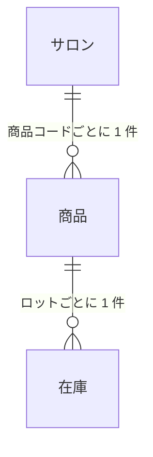
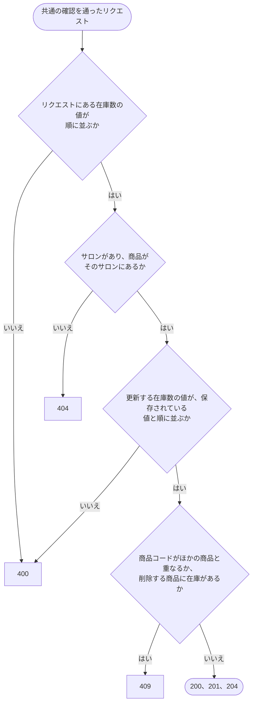
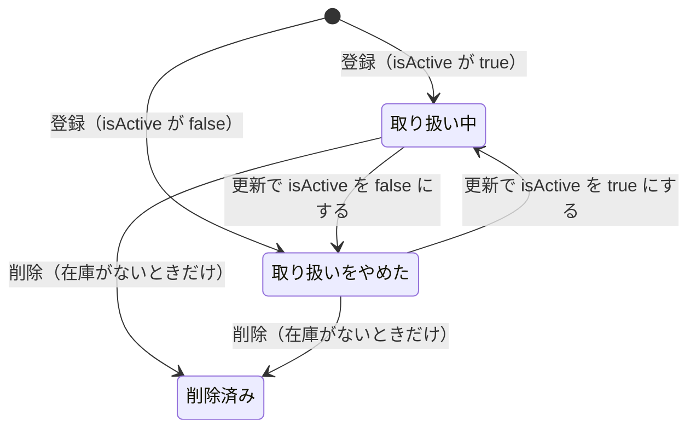

# 商品

商品は、サロンが店頭で売るもの（シャンプー、スタイリング剤など）と、施術で使うもの（カラー剤、ブリーチ剤など）の台帳です。サロンごとに持ち、価格、数量の単位、仕入先、発注の目安になる在庫数の 3 つの値（最低在庫数、発注点、最大在庫数）を記録します。商品がいまいくつあるかは、商品ではなく、在庫が持ちます。

## 何をどこに持つか

商品に持たない情報は、次の場所にあります。

| 情報 | 場所 |
|---|---|
| 商品がいくつあるか、ロット、使用期限、保管場所、在庫の移動、棚卸し、在庫評価額 | [在庫](./inventory.md) |
| 仕入先への発注 | [発注](./purchase-orders.md) |
| 在庫が足りない、多すぎる、使用期限が近いか過ぎたことの知らせ | [在庫のアラート](./inventory-alerts.md) |
| 売った時点の商品の名前と金額 | [売上台帳](./sales.md) |
| 施術で使った商材 | [施術記録](./treatments.md) |

**売上は、商品の名前と価格を使いません。** 売った時点の名前と金額は、売上の明細が持ちます。商品の名前や価格を変えても、売上は変わりません。

## 誰が扱えるか

- **商品を読めるのは、管理者と、そのサロンのオーナー、マネージャー、スタッフです。** 施術で商品を使い、店頭で売るスタッフが、商品を知る必要があるからです
- **登録、更新、削除は、スタッフにはできません。** メニューや支払い方法と同じく、オーナーとマネージャーが決めるものだからです
- **顧客は、商品を読めません。** 商品は、仕入価格と仕入先を持つからです

## 確認の順序

どの API にも共通の確認（認証、権限、ID と値の形）のあと、次の順に確かめ、合わなかったところのステータスを返します。そのオペレーションにない確認は、飛ばします。

**更新では、在庫数の値の順を 2 度確かめます。** リクエストにある値どうしの順は、値の形と一緒に確かめます。リクエストにない値との順は、商品があることを確かめたあとに確かめます。保存されている値と比べるからです。

## 在庫数の 3 つの値は順に並ぶ

最低在庫数（`minimumStock`）、発注点（`reorderPoint`）、最大在庫数（`maximumStock`）は、null でないものの間で、この順に並びます。同じ値でもかまいません。

- **発注点は、最低在庫数以上です。** 在庫が最低在庫数を下回ってから発注したのでは、最低在庫数を保てないからです
- **最大在庫数は、発注点以上です。** 発注点が最大在庫数より上だと、納品のたびに最大在庫数を超えるからです
- **更新では、更新後の値どうしを比べます。** リクエストにない値は、保存されている値です。null にした値は、比べません
- 保存されている発注点や最大在庫数を上回る最低在庫数にするときは、同じリクエストで、その値も書き換えるか、null にします

## 規則に合わない値の答え

商品の規則に合わない値は、400 の `errors` に、次の `field` と `rule` で入ります。

| 誤り | `field` | `rule` |
|---|---|---|
| リクエストにある在庫数の 2 つの値の順が違う | 上の値（`reorderPoint`、`maximumStock`） | `custom` |
| 更新する在庫数の値と、保存されている値の順が違う | リクエストにあるほうの値 | `custom` |

**順を比べるのは、在庫数の 3 つの値がどれも、それ自体の規則に合うときだけです。** 型の違う値や、欠けたプロパティがほかにあるときも、比べません。

## 取り扱いをやめることと、削除

- **取り扱いをやめるときは、削除ではなく、`isActive` を false にします。** 在庫が残っていてもやめられ、あとで true に戻せます。削除は、在庫のない商品にだけできて、戻せません
- **`isActive` は、取り扱い中かどうかの印です。** 商品の台帳は、取り扱いをやめた商品を、取り扱い中の商品と同じに扱います。在庫、売上、施術記録での扱いは、それぞれの要件にあります
- **削除した商品に、在庫は残りません。** 在庫のある商品は、削除できないからです

## 同時に届いたリクエスト

- **同じ商品コードの登録が同時に届くと、1 件が 201 で、ほかは 409 です。** 2 つの商品を同じ商品コードにする更新も同じで、先に確定した書き込みが通り、あとの書き込みは 409 です
- **同じ商品の更新と削除は、1 件ずつ行います。** 違う項目の更新が同時に届くと、どの項目も残ります。削除のあとになった更新は 404 で、何も書きません。同じ商品の削除が同時に何件届いても、204 は 1 件で、ほかは 404 です
- **在庫数の 3 つの値の順は、同時の更新でも崩れません。** 最低在庫数だけの更新と、最大在庫数だけの更新が同時に届くと、あとの更新は、先の更新が書いた値と比べ、順が違えば 400 です
- **削除は、その商品の在庫の登録が終わるのを待ちます。** 在庫ができていれば 409 です
- **更新と削除は、ほかの商品やサロンへの書き込みを待ちません。**

## 持たないもの

- **顧客に商品を見せるオペレーション。** 顧客は、どのサロンの商品も読めません
- **商品のレスポンスの在庫数。** 在庫は、在庫のオペレーションで読みます
- **カテゴリ、ブランド、仕入先の台帳。** `category`、`brand`、`supplier` は、サロンが書く文字列です
- **価格を変えた履歴。** 残るのは、いまの価格と、最後に書いた時刻（`updatedAt`）だけです
- **価格どうしを比べる規則。** 仕入価格より安く売ることも、希望小売価格より高く売ることもあるからです
- **店頭で売るか、施術で使うかの、どちらかでなければならないという規則。** どちらでもない商品（備品など）も登録できます
- **画像と安全データシートのファイル。** `imageUrl` と `safetyDataSheet` は、ほかの場所にあるファイルの URL です
- **削除した商品を戻すオペレーション。** 戻すかもしれない商品は、削除せずに、取り扱いをやめます
- **サロンを登録したときに用意される商品。** 新しいサロンの商品は、空です

## 関連

- プロパティの意味と値の規則、オペレーションごとの権限と応答: コントラクト（`specs/models/inventory.tsp`、`specs/operations/inventory-operations.tsp` の `ProductCrud`）
- どの API にも共通の規則: [API リファレンス](https://napzak5.github.io/typescript-backend-api-first-lesson/)
