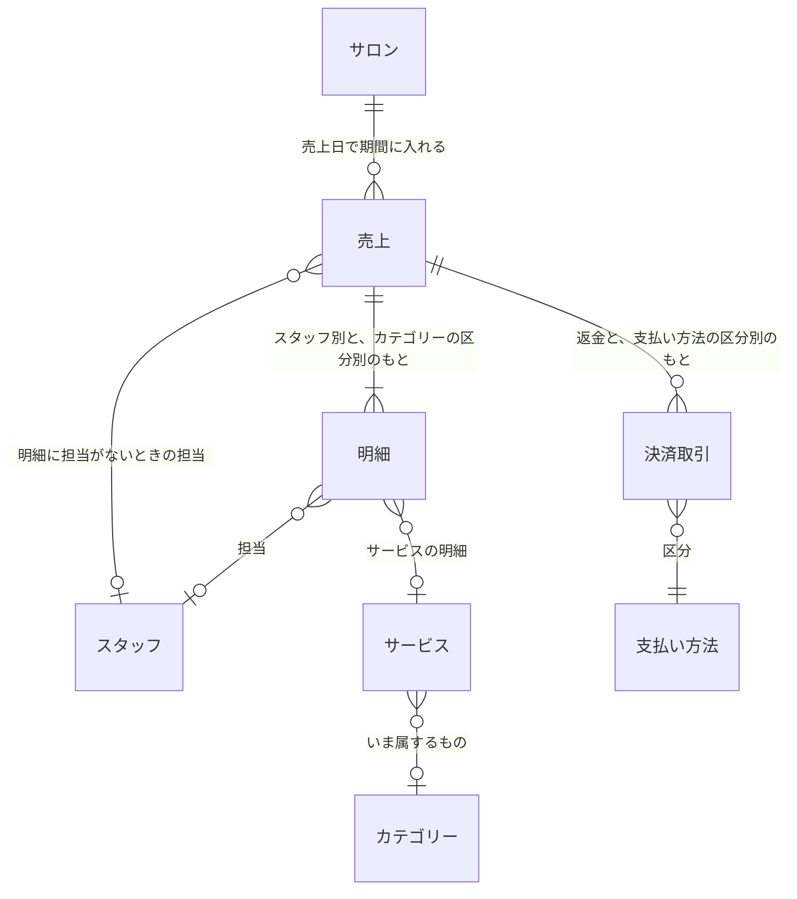

# 売上レポート

売上レポートは、サロンの売上を数えた値です。期間の合計と、支払い方法の区分、サービスのカテゴリーの区分、スタッフ、1 日、日・週・月の区切りごとの値があります。期間の売上を、1 日を 1 行にした CSV ファイルでも返します。サロンを運営する人が、経営のために読みます。

## 何をどこに持つか

レポートは、自分の記録を持ちません。売上台帳の、次の記録から数えます。

数えるもとの記録の規則は、次の場所にあります。

| 情報 | 場所 |
|---|---|
| 売上と明細、売上日、取り消し | [売上台帳](./sales.md) |
| 決済取引、返金、支払い方法 | [支払い](./payments.md) |
| 顧客 1 人の、予約と売上の集計 | [顧客台帳](./customers.md) |

## 誰が扱えるか

**レポートを読めるのは、管理者と、そのサロンのオーナー、マネージャーです。スタッフは読めません。** 売上台帳は、レジに立つスタッフも扱います。レポートは、サロン全体の売上と、スタッフ一人ひとりの売上を見せる、経営の情報だからです。

## クエリの規則

- **期間に既定値はありません。** 期間は売上日の期間で、売上日は、サロンのタイムゾーンでの日付です。「今月」や「今日」がどの日かは、サロンのタイムゾーンで決まるので、クライアントが日付にして渡します
- **期間は、両端を含めて 366 日までです。** うるう年の 1 年が入る長さです。保存した集計ではなく、売上台帳から数えるので、1 回に数える期間を限ります（[集計を保存しない理由](#集計を保存しない理由)）

## 数える売上

- **どのオペレーションも、同じ売上を、同じ数え方で数えます。** 数えるのは、`salonId` のサロンの、売上日が期間内の、取り消していない売上です。取り消した売上は、明細と決済取引も含めて、どの値にも入りません。同じ期間の値は、オペレーションをまたいで一致します
- **支払いが済んでいない売上も数えます。** 売上は、売った記録だからです。支払い方法の区分ごとの入金だけは、受け取った決済取引を数えます
- **返金は、返金した日ではなく、売上の売上日の側で数えます。** 11 月の売上を 12 月に返金すると、11 月のレポートの返金に入ります
- **金額は、売上に記録した値です。サービスのカテゴリーと、スタッフの表示名だけは、いまの値です。** 明細は、売ったときのカテゴリーを持たないからです。サービスを別のカテゴリーに移すと、過去の売上も、移した先で数えます

## 集計を保存しない理由

- **レポートは、リクエストのたびに売上台帳から数え、どこにも保存しません。** 保存した集計は、売上の作成、更新、取り消し、支払いの記録、返金のたびに直す必要があります。直し漏れがあれば、レポートが売上台帳と食い違います。期間を 366 日までにして売上台帳から数えるほうが、正しさを保ちやすいからです
- **同じ期間のレポートでも、読む時点によって変わります。** 売上をあとで直すと、直した後の値で数えます。あとで取り消すと、その売上は数えません

## 規則に合わない値の答え

売上レポートの規則に合わない値は、400 の `errors` に、次の `field` と `rule` で入ります。

| 誤り | `field` | `rule` |
|---|---|---|
| `endDate` が `startDate` より前 | `endDate` | `custom` |
| 期間が、両端を含めて 366 日を超える | `endDate` | `custom` |

**`startDate` か `endDate` そのものが規則に合わないときは、期間の前後と長さを確かめません。** その日付は、期間について何も言わないからです。

## 削除されたスタッフとサービス

売上は、売った記録です。売ったあとの削除では、数え方を変えません。

- **削除されたスタッフも、無効にしたスタッフも、スタッフ別の売上に載ります。**
- **削除されたサービスの明細も、そのサービスがいま属するカテゴリーの区分で数えます。**

## 同時に届いたリクエスト

**1 つのレポートの値は、1 つの時点の売上台帳から数えます。** 期間の合計、支払い方法の区分ごとの入金、カテゴリーの区分ごとの売上、スタッフ別の売上は、互いに食い違いません。

## 持たないもの

- **Excel と PDF のファイル、スタッフ別や区分別の CSV ファイル。** 出力は、日ごとの売上の CSV ファイルだけです。Excel は CSV ファイルを開けます
- **出力したファイルの保存と、ダウンロード URL。** ファイルは、応答の本文で返します
- **前の期間や前年との比較。** 比べる期間は、それぞれ読みます
- **顧客別、時間帯別、予約の経路別、商品別の集計。** 顧客 1 人の集計は、顧客台帳の統計にあります
- **サービスのカテゴリーの名前ごとの集計。** カテゴリーは、区分ごとに合わせて数えます
- **スタッフの歩合の集計。** 歩合は、売上の明細に記録するだけです
- **スタッフごとの顧客満足度。** 売上は、満足度を持ちません。スタッフごとの評価は、[レビュー](./reviews.md) の集計にあります

## 関連

- プロパティの意味と値の規則、オペレーションごとの権限と応答: コントラクト（`specs/models/payment.tsp`、`specs/operations/payment-operations.tsp` の `SalesReportCrud`）
- どの API にも共通の規則: [API リファレンス](https://napzak5.github.io/typescript-backend-api-first-lesson/)
- 売上と明細、売上日: [売上台帳](./sales.md)
- 決済取引と返金: [支払い](./payments.md)
